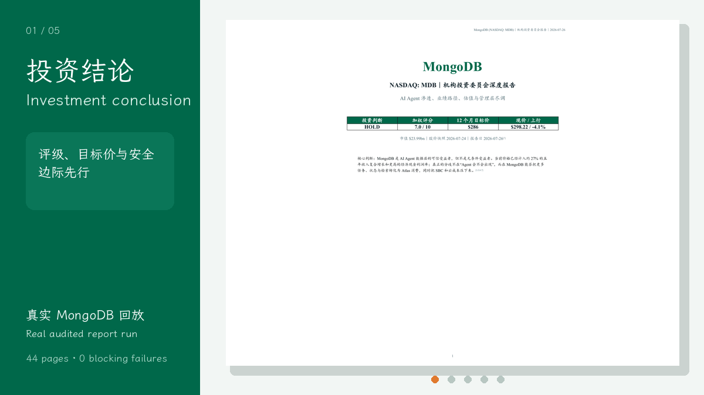
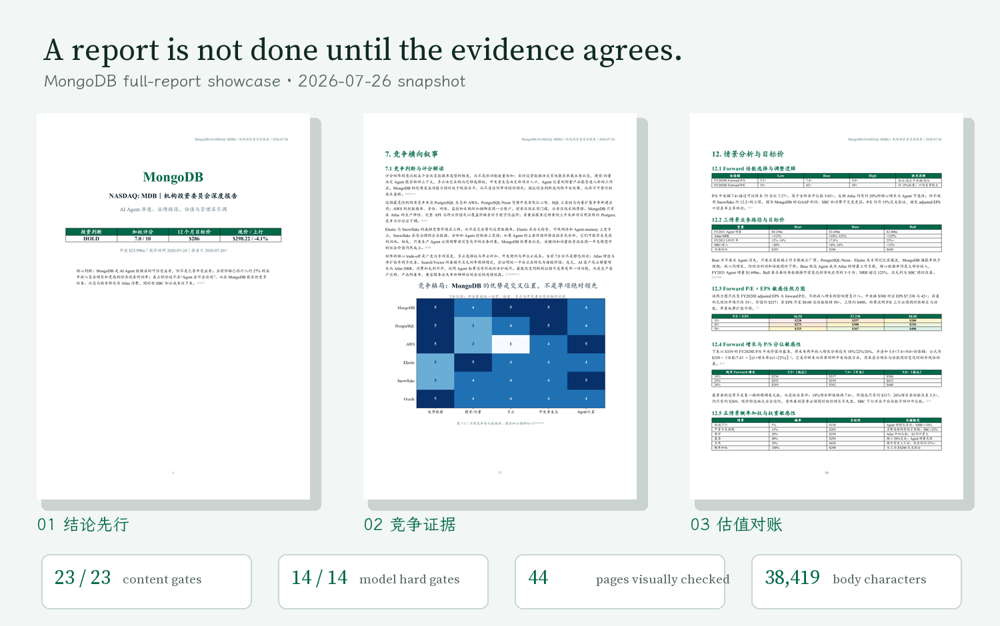

<sub>🌐 <b>中文</b> · <a href="README_EN.md">English</a></sub>

<div align="center">

# Public Investment Analysis

> *「别让一份看起来像研报的答案，绕过模型、来源和审计就进入投委会。」*

[](SKILL.md)
[](https://skills.sh/Mai-coding/public-investment-analysis)
[](examples/repository-check-2026-08-02.txt)
[](LICENSE)

**把上市公司研究拆成五个有交接、有门禁、有可见产物的阶段：研究、建模、估值、图表和 IC 报告。**

[看实战](#showcase) · [看交付物](#它会交付什么) · [快速开始](#快速开始) · [触发方式](#触发方式) · [验证](#验证与当前-showcase-状态) · [安全边界](#安全边界)

</div>

---

<a id="showcase"></a>

## 真实案例：MongoDB full report

<p align="center">
  
</p>

<p align="center"><sub>真实运行回放：投资结论 → 竞争结构 → 情景与敏感性 → 概率权重 → 估值交叉验证。市场快照为 2026-07-26，不代表当前建议。</sub></p>



这不是概念样稿，而是一份通过当前终稿门的真实报告：**44 页、正文 38,419 字、23/23 内容门槛、14/14 模型硬门槛、10/10 仓库检查，独立验收 PASS**。完整检查记录、已知限制、源页面与生成文件哈希见 [MongoDB showcase 说明](examples/mongodb/README.md) 和 [manifest](examples/mongodb/showcase_manifest.json)。

> 完整 PDF 不随仓库分发。展示页避开第三方产品架构图片，只保留本项目生成的结论、竞争、情景和估值页面；动图与结果卡可用 [showcase 构建脚本](scripts/build_showcase.py) 重建。

---

## 它解决什么问题

事情是这样的：让 Agent “分析一只股票”很容易，难的是确认它有没有把来源、预测、估值和结论真正接起来。

一个数字可能有出处，却没有进入模型；一张图可能很好看，却和估值使用了不同口径；一份 30 页报告也可能在关键假设、稀释股本或引用链上静默失败。

这个 Skill 把公开公司研究变成一条受门禁约束的工作流。每个阶段读取上一阶段产物，产生明确交付物，并在失败时停止。它尤其适合需要 DCF、远期 P/E/P/S、SBC/期权稀释、回购和来源追踪的上市公司研究。

---

## 它会交付什么

| 模式 | 交付物 | 适合场景 |
|---|---|---|
| Quick memo | 2–3 页决策备忘录：建议与目标价、priced-in vs. variant view、风险、tripwires、六个月行动图 | 财报前后、快速筛选、持仓复盘 |
| Full report | 研究底稿 + Excel 经营模型 + 估值分析 + PNG 图表 + 典型 30–40 页 IC Report DOCX | 首次覆盖、投委会、深度复盘 |

完整模式按五个阶段运行：

```text
公开来源 → 公司研究 → Excel 模型 → DCF/倍数估值 → 图表 → IC Report DOCX
              PASS          PASS             PASS       PASS
```

每个 `PASS` 都来自实际脚本或人工检查点，不是正文里的自我声明。

---

## 快速开始

公开仓库发布后，一行安装：

```bash
npx skills add Mai-coding/public-investment-analysis
```

验证本地检出目录：

```bash
cd public-investment-analysis
npx skills add . --list
```

完整报告脚本需要 Python 3.10+。依赖可用以下命令安装：

```bash
python -m pip install -r requirements.txt
```

装完后对 Agent 说：

```text
用 public-investment-analysis 分析 MongoDB（MDB），先做中文 quick memo。
基于最新公开文件，给出 12 个月目标价、priced-in vs. variant view、三项 killer risks 和六个月行动图；缺失数据不要猜。
```

> 首次运行需要目标公司、行业，以及可读取的公开文件或可检索公告的 ticker。核心 Skill 不要求付费 API key；检索能力取决于所用 Agent runtime。

---

## 触发方式

- “帮我快速判断 MDB 现在值不值得继续研究。”
- “做一份 2–3 页中文 quick memo，重点看市场预期和 variant view。”
- “对 MRVL 做完整的上市公司 IC 分析，从研究到 DOCX。”
- “把这组 10-K、10-Q 和 earnings call 建成可审计的经营模型。”
- “用 DCF、远期 P/E 和 P/S 交叉估值，统一到同一个预测年度。”
- “检查 SBC、期权、回购和 diluted shares 对每股价值的影响。”
- “审计这份模型与报告是否存在来源、口径或引用断链。”

不适用于私人股权轮次建模、早期项目 MOIC/IRR、自动下单或个性化投资顾问服务。

---

## 它和普通股票分析有什么不同

| 维度 | 常见一次性问答 | Public Investment Analysis |
|---|---|---|
| 工作方式 | 一次生成整篇答案 | 五阶段交接，每阶段有进入条件与停止点 |
| 预测 | 结论和数字可能分开生成 | 收入驱动 EBITDA；估值读取模型输出 |
| 股本 | 容易只看 basic shares | 显式处理 SBC、期权、稀释股本和回购 |
| 估值 | 方法并列但口径未必一致 | DCF + 远期 P/E/P/S，并约束预测年度一致 |
| 来源 | 链接可能只出现在正文 | 数字、快照日期、来源台账和终稿引用互相校验 |
| 交付门槛 | “看起来完成”即可 | 机器审计 FAIL 会阻止推进或交付 |
| 上下文 | 一次预载大量说明 | 按任务即时加载引用，减少无关上下文 |

---

## 安全边界

- 不编造缺失的公告、共识数据、图片、模型输入或前序任务产物；未知项保持未知。
- 默认在每个任务完成后展示交接卡并停下，除非用户明确要求连续执行。
- 任何机器审计 `FAIL` 都阻止进入下一阶段或交付；人工视觉/阅读检查不能被脚本替代。
- 不执行交易，不替用户联系公司或券商，也不擅自发布研究结论。
- 只把公开来源用于公司研究；不得把 API key、cookie、私人路径或账户信息写入产物。
- 输出是研究工作流产物，不构成投资建议；投资决策仍由使用者负责。

---

## 文件结构

```text
SKILL.md                 # Agent 入口、五阶段流程与全局门禁
references/              # 分阶段规则、方法、schemas 与按需加载映射
scripts/                 # 抓取、建模辅助、审计与回归测试
assets/                  # 色板、提示词与可再分发 OFL 字体
examples/                # 可复制触发示例与真实验证记录
requirements.txt         # Python 运行依赖
LICENSE / NOTICE         # Apache-2.0 与上游、第三方归属
```

---

## 验证与当前 showcase 状态

仓库级检查：

```bash
python scripts/run_repo_checks.py
```

当前记录为 **10 PASS / 0 FAIL**，覆盖引用完整性、许可证与字体、上下文预算、来源覆盖、showcase 哈希与渲染规格、四组回归测试和 Python 语法。可核对[运行摘要](examples/repository-check-2026-08-02.txt)。

本地安装器识别也已实跑：`npx skills add . --list` 找到且只找到 `public-investment-analysis`。

首个 full-report showcase 已通过模型、内容、深度、44 页人工视觉检查和独立验收。公开页与可复现生成脚本见 [MongoDB case](examples/mongodb/README.md)；检查数字与文件哈希见 [showcase manifest](examples/mongodb/showcase_manifest.json)。

可复制的 quick-memo 输入与验收合同见 [`examples/`](examples/README.md)。

---

## 致谢与第三方资产

本项目基于 [Anthropic Financial Services](https://github.com/anthropics/financial-services) 的公开工作流思想进行大量改造，具体归属见 [NOTICE](NOTICE) 与 [THIRD_PARTY_NOTICES.md](THIRD_PARTY_NOTICES.md)。

随仓库分发的 [LXGW WenKai](https://github.com/lxgw/LxgwWenKai) 与 [Source Serif 4](https://github.com/adobe-fonts/source-serif) 均遵循 SIL Open Font License 1.1；字体授权文件位于 [`assets/fonts/`](assets/fonts/README.md)。

---

## License

[Apache License 2.0](LICENSE)
