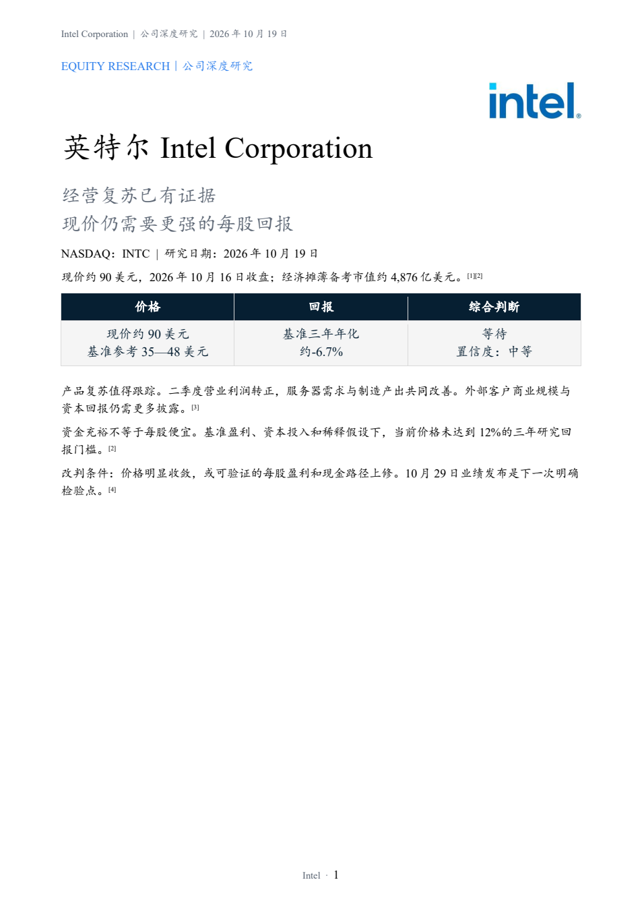
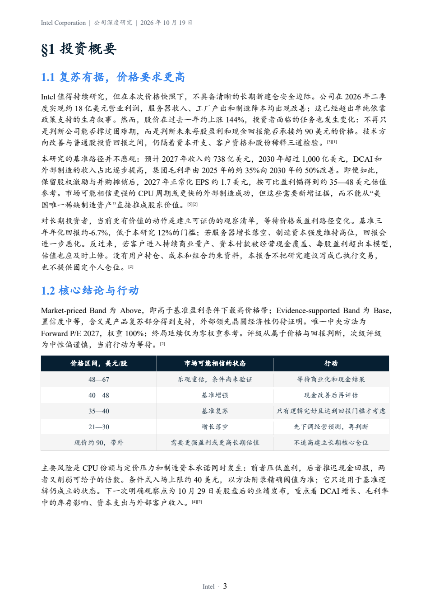
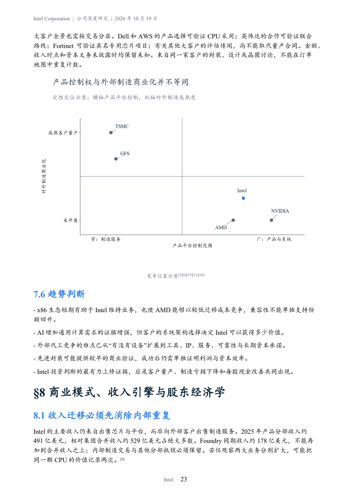
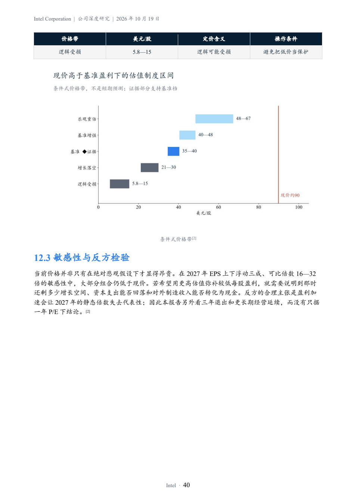
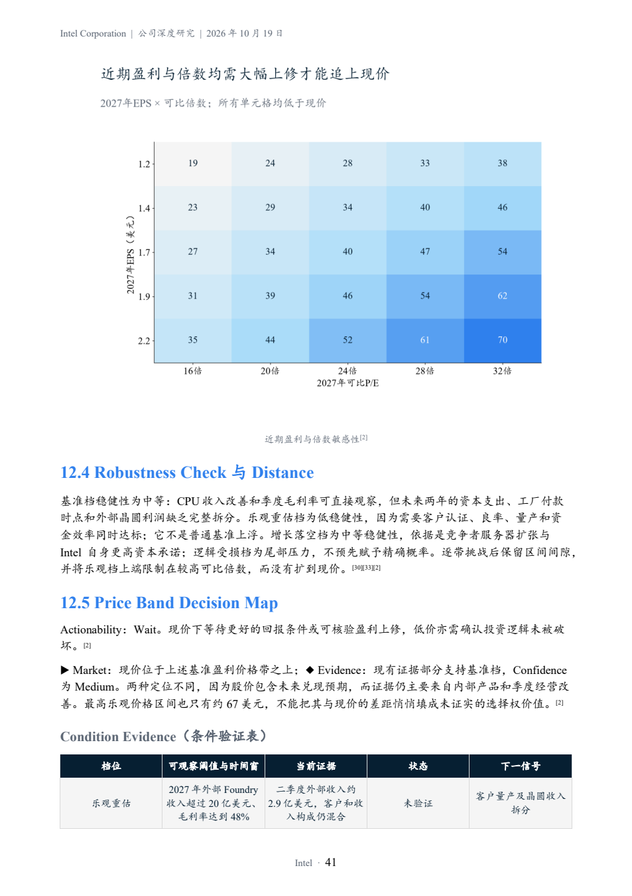

# Intel: five selected report pages

This is a real run of the full-report workflow, dated **2026-10-19**, using the **2026-10-16 market close**. It demonstrates the current Price Band framework and report presentation. It is a historical research example, not a current recommendation.

**Publication boundary: exactly five original report pages and previews derived from those pages. The full 58-page PDF, DOCX and financial model are not included.** No other Intel report pages, embedded report attachments or archives are distributed. The complete methods, assumptions and Sources appendix remain outside this public excerpt.

## Open the five pages

Click a thumbnail to read the full-resolution PNG. Page numbers refer to the original PDF, not a new five-page report. The images preserve the original page contents, including continuation text where a section crosses pages.

| Selected page | Original PDF page | Preview |
|---|---:|---|
| Cover / 封面 | 1 | [](source-pages/cover.png) |
| Investment summary / 投资摘要 | 3 | [](source-pages/investment-summary.png) |
| Competitive positioning / 竞争象限 | 23 | [](source-pages/competition-quadrant.png) |
| Price bands / 价格区间 | 40 | [](source-pages/price-bands.png) |
| Earnings and multiple sensitivity / 盈利与倍数敏感性 | 41 | [](source-pages/valuation-sensitivity.png) |

## Recorded validation and limits

| Check | Recorded result |
|---|---|
| Model/artifact audit | 18 PASS / 1 WARN / 0 FAIL |
| Report content audit | 38 PASS / 2 WARN / 0 FAIL |
| Depth audit | PASS |
| Recorded final review | PASS; native Word pagination and rendered pages reviewed |
| Selected-page comparison | All five approved PNGs match pixels rendered from the source PDF |
| Public preview QA, 2026-10-20 | Five selected pages, five GIF frames, overview and result card visually reviewed |

These results describe the local report's recorded checks, not a fresh independent investment review. The artifact WARN concerns the scope of prior-version regression checks; the content WARNs require native pagination and image-marker review. Pagination and printed output were reviewed, while the Word editing-marker UI and native Excel desktop recalculation were not independently inspected. The report records material economic-data gaps; these excerpts are not a substitute for its full qualifications.

The [manifest](showcase_manifest.json) records the original PDF hash, page mapping, approved PNG hashes and preview hashes. The PDF itself stays private. Branding is used to identify the subject; this independent example is not affiliated with or endorsed by Intel Corporation.

## Rebuild previews

From the repository root:

```bash
python scripts/build_intel_showcase.py
python scripts/showcase_audit.py
```

The builder uses only these five PNGs and the bundled open fonts. It does not need or load the full report. It recreates the [GIF](../../assets/showcase/intel-workflow.gif), [overview](../../assets/showcase/intel-showcase.png), [result card](../../assets/showcase/intel-result-card.png) and local manifest.

The public-package audit enforces the five-page allowlist and rejects full report/model documents and archives. The [MongoDB case](../mongodb/README.md) remains a separate historical example.
